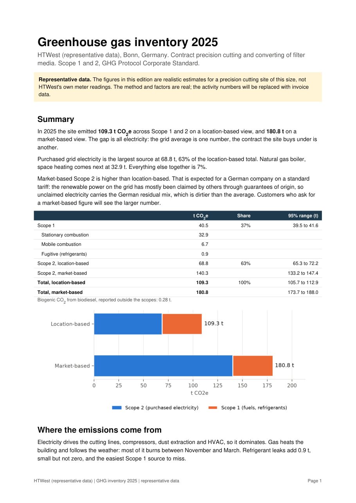

# GHG inventory, Scope 1 and 2: Precision Cutting Site

[](https://ghg-inventory-io.streamlit.app/)

**Live demo: [ghg-inventory-io.streamlit.app](https://ghg-inventory-io.streamlit.app/)**. It runs on representative data. You can edit anything and download the results, and nothing is saved. If it has been idle, it takes about a minute to wake up.

A Python tool that builds a greenhouse gas inventory for a contract precision cutter company, following the GHG Protocol Corporate Standard. It reads activity data from an Excel workbook and emission factors from versioned, cited factor files. It produces a line-item CSV, an Excel workpaper for an auditor, tables ready for Power BI, and a PDF report someone can actually read.

The operation it is modelled on is HTWest GmbH, a contract cutter of filter media in Bonn.

## Read this first: the data is representative

This version runs on realistic figures for a site of this type, not on actual meter readings or invoices. The method, factors and code are the real thing. The activity numbers are placeholders. When real bills are available, they go into the input workbook and the inventory becomes a real-company inventory with no code changes.

## Results on the representative data (2025)

The full report is in [docs/sample_report.pdf](docs/sample_report.pdf). Its first page:



| | t CO2e |
|---|---:|
| Scope 1 (gas heating, vans, forklift, refrigerant leaks) | 40.5 |
| Scope 2, location-based | 68.8 |
| Scope 2, market-based | 140.3 |
| **Total, location-based** | **109.3** |
| **Total, market-based** | **180.8** |

with this representative data:
Electricity is 63% of the location-based total. That is the expected shape for a cutting operation: compressors, extraction and the cutting lines all run on power.

Market-based Scope 2 is about twice the location-based figure. In Germany most renewable power is claimed through guarantees of origin, so electricity bought on a standard tariff is counted at the residual mix (701 g/kWh in 2025), well above the grid average (344 g/kWh). Customers who ask suppliers for market-based figures will see the bigger number. The report shows both and spells out what it would take to close the gap.

A rough Scope 3 screen of the incoming filter media comes out at about 1,200 t CO2e, around seven times Scope 1 and 2 combined. It sits outside the inventory boundary (more on that below), but it shows where most of the full footprint lies.

## How it works

```
emissions per gas = activity x factor per gas
CO2e              = sum(emissions per gas x GWP)
```

The arithmetic is simple. Most of the work is in choosing the scopes, the factors and the boundary correctly.

### Per gas, then CO2e

Combustion emits CO2, CH4 and N2O, and refrigerants leak HFCs. The tool calculates each gas and then applies a declared GWP set (IPCC AR6 by default, AR5 available). DESNZ publishes its per-gas values already in CO2e using AR5, so the tool divides back to kg of each gas first. A test confirms that under AR5 the results match DESNZ's published totals exactly.

### Two Scope 2 methods

Location-based uses the Umweltbundesamt grid factor. Market-based follows the hierarchy in the GHG Protocol Scope 2 Guidance: kWh covered by cancelled guarantees of origin count at zero, then the supplier's own disclosed factor (the *Stromkennzeichnung* every German bill must carry under §42 EnWG), then the AIB residual mix. Whichever applies is set in `config.yaml`.

### Refrigerants

Air conditioning and refrigerant air dryers leak HFCs, and this is the Scope 1 source most often missed. The tool supports the GHG Protocol screening method (charge times leak rate) and a simplified mass balance (refrigerant topped up during the year).

### Uncertainty

Every activity row carries a data quality score from 1 to 5, and every factor has its own uncertainty. A Monte Carlo run (10,000 draws) gives 95% ranges for each total. Each factor's error is the same in every month that uses it, so it does not average out the way the activity errors do.

### Audit trail

Every output line traces back to a cell in the input workbook and to a factor ID with its source. Each run writes a manifest with SHA-256 hashes of the config, the input and the factor files.

## Emission factors

| Factor | Value | Source |
|---|---|---|
| German grid electricity, location-based | 0.344 kg CO2/kWh | Umweltbundesamt, 2025 (estimate, published March 2026) |
| German residual mix, market-based | 0.70147 kg CO2/kWh | AIB European Residual Mixes 2025, Table 2 |
| Natural gas, gross CV | 0.18296 kg CO2e/kWh | UK DESNZ GHG Conversion Factors 2025 |
| Diesel, average biofuel blend | 2.57082 kg CO2e/litre | UK DESNZ GHG Conversion Factors 2025 |
| LPG | 1.55713 kg CO2e/litre | UK DESNZ GHG Conversion Factors 2025 |
| Refrigerant GWPs | R-32: 771, R-410A: 2,256 | IPCC AR6 (blends from ASHRAE 34 compositions) |
| Paper, primary production (Scope 3 screen only) | 1,345 kg CO2e/tonne | UK DESNZ GHG Conversion Factors 2025 |

The per-gas splits, table references and URLs are in `factors/*.yaml`. When a new year's factors come out, add a new file (for example `defra_2026.yaml`) and point `config.yaml` at it. Old runs stay reproducible.

## Boundary

- Organisational: the Bonn site, under operational control.
- Scope 1: gas for space heating, diesel for the vans, LPG for the forklift, refrigerant leaks.
- Scope 2: purchased electricity. An electric forklift would show up here rather than in Scope 1.
- Scope 3 is excluded. For a converting business, the embodied emissions of the incoming material are almost certainly the largest category, followed by freight, waste and commuting. I left Scope 3 out because Scope 1 and 2 are what the company controls and can measure from its own bills. The report includes an indicative screen of the material category so the exclusion is visible and sized.

## Using it

```bash
pip install -e ".[dev]"
python -m ghg_inventory run --config config.yaml
```

Outputs go to `output/`:

| File | What it is |
|---|---|
| `ghg_inventory_report.pdf` | The report: summary, sources, method, boundary, uncertainty, recommendations, framework mapping, limitations |
| `ghg_inventory.xlsx` | Workpaper for an auditor: summary, every line, factors, activity, refrigerants, energy, uncertainty, intensity, abatement, Scope 3 screen, framework mapping |
| `inventory_lines.csv` | One row per activity row and method, with per-gas kg, CO2e, factor and evidence reference |
| `tables/` | Star schema for Power BI or Tableau: `fact_emissions` (one row per line per gas), `dim_source`, `dim_factor`, `dim_activity` |
| `run_manifest.json` | Hashes of every input, factor versions, totals, timestamp, git commit |

### Putting in real data

1. `python -m ghg_inventory make-template` writes a blank input workbook to `templates/`.
2. Fill in the Activity sheet, one row per invoice, meter reading or fuel-card statement. Sources, months and units are dropdowns. Fill in the Refrigerants sheet from equipment nameplates or the F-gas service log, and the Metrics sheet with output, headcount, floor area and revenue.
3. Point `input:` in `config.yaml` at the file, set `data_status: actual`, and run.

If the gas bill gives m³ rather than kWh, put the *Zustandszahl* and *Brennwert* from the bill into `unit_conversions` for the gas source. If the supplier's electricity label gives a CO2 factor, set `uncovered_basis: supplier_specific` and fill in `supplier_specific`.

Errors point at cells, for example `Activity!C7 (quantity): Input should be greater than or equal to 0`.

A folder containing `activity.csv`, `refrigerants.csv` and `metrics.csv` works as input too.

### The app

```bash
pip install -e ".[ui]"
python -m streamlit run app.py
```

It opens in the browser at `http://localhost:8501` and does everything the command line does, on the same files.

- **How to use:** a step-by-step guide, from gathering the bills to exporting the report, with a link to the right page at each step.
- **Overview:** the location- and market-based totals side by side, then breakdowns by source and month, energy and intensity, uncertainty ranges, where each figure goes in VSME, ESRS and ISO 14064, and every calculated line with a filter.
- **Activity data:** the input workbook as editable grids. You can type into cells, add rows, paste from Excel, or upload a filled-in workbook. Dropdowns cover sources, months, units and data quality. Every edit is checked straight away. Errors name the row, and warnings catch a month far above the rest (usually a typo) or the same bill entered twice. Save to workbook writes `data/activity_input.xlsx` and keeps the old file as a backup.
- **Settings:** organisation, reporting year, data status, GWP set, the electricity contract (guarantee-of-origin share, residual mix or the supplier's label factor), the gas m³ conversion, prices and the CO2 price. Save settings writes `config.yaml`, keeps its comments, and backs up the previous version.
- **Scenarios:** the abatement options with their assumptions as sliders. The cost-per-tonne chart and the ranking update as you move them.
- **Export:** builds the PDF, the Excel workpaper, the CSV and the Power BI tables, and offers each as a download. It asks you to save first, so the manifest hashes match the files the numbers came from.
- **Factors and sources:** the emission factors with their citations, the source register and the refrigerant GWPs. These are read-only on purpose. A factor typed into a form has no source, so new factors go in as new cited files.

On a public host the app runs in demo mode. Each visitor's edits stay in their own browser session. The save buttons become downloads (the edited workbook and `config.yaml`), and Export builds the files from the session without writing to disk. Demo mode switches on by itself on Streamlit Community Cloud. Set `GHG_APP_MODE=demo` or `GHG_APP_MODE=local` to force either mode.

The app holds no calculation logic of its own. It calls the same functions as the command line, so both produce identical numbers.

Run it on your own machine for real data. The public demo uses representative data only.

#### Deploying the demo

The app deploys to Streamlit Community Cloud straight from this repository. Sign in at share.streamlit.io with GitHub, choose Create app, and pick this repo, branch `main` and main file `app.py`. Under Advanced settings, choose Python 3.12. Dependencies come from `requirements.txt` and the theme from `.streamlit/config.toml`.

### Tests

```bash
python -m pytest
```

62 tests cover:

- the arithmetic, against hand-checked values
- reconciliation with DESNZ's published totals, including the refrigerant blend GWPs
- the market-based hierarchy and unit conversion
- Monte Carlo behaviour and abatement costs
- Excel round trips and cell-level errors
- the app's grid conversion and plausibility checks
- an end-to-end run and a smoke test of the app

## Recommendations section

The report turns the inventory into decisions. Each option in `config.yaml` (fixing compressed-air leaks, recovering compressor heat, LED lighting, rooftop solar, a heat pump, electric vans, a green tariff) has its savings calculated through the same engine. Each gets a cost per tonne from annualised capex, running costs and energy savings. Some results worth knowing:

- Fixing compressed-air leaks and recovering compressor heat pay for themselves. Compressed air is usually the most wasteful use of electricity in a plant like this.
- A green tariff is the cheapest way to cut the market-based number (about EUR 14 per tonne), but it changes nothing physically. The report says so.
- On the current tariff a heat pump *raises* market-based emissions, because the extra electricity is counted at the residual mix. It only pays off in carbon terms alongside a cleaner electricity contract.
- The national CO2 price (BEHG) already adds about EUR 2,200 a year to the gas and fuel bills, and fuels move into EU ETS2 in 2028.

These figures use typical parameters, not quotes or measurements, and the options overlap, so their savings do not add up.

## Frameworks

The report maps each figure to where a customer would want it: GHG Protocol (Scope 1, dual Scope 2, biogenic CO2), the EFRAG voluntary SME standard (VSME B3, which is what CSRD-reporting customers tend to send to suppliers), ESRS E1-5 and E1-6, and ISO 14064-1 categories 1 and 2.

The data model (an activity ledger, a separate versioned factor library, a per-gas fact table) follows the same pattern as the carbon accounting platforms (Persefoni, Watershed, Sweep), on a scale that suits a single site.

## Limitations

The data is representative, not HTWest's. The inventory stops at Scope 1 and 2, so it is a partial footprint on purpose.

The fuel factors are UK averages. German fuels are close but not identical, and the UBA 2025 grid factor is an estimate that may be revised. Both electricity factors are CO2 only and leave out upstream emissions, which is standard for German Scope 2 reporting but understates the full effect a little.

Refrigerant leak rates are defaults wherever there are no service records, and the abatement costs are indicative.


## Layout

```
config.yaml               organisation, boundary, sources, market instruments, prices, abatement options
factors/                  versioned factor libraries with citations
data/activity_input.xlsx  representative input (rebuild with scripts/build_representative_data.py)
templates/                blank input template
ghg_inventory/            models, factors, gwp, calc, uncertainty, scenarios, excel_io, outputs, chart, report, cli, ui_state
app.py                    Streamlit app (python -m streamlit run app.py)
.streamlit/config.toml    app theme
tests/
```

## Sources

- GHG Protocol Corporate Standard and Scope 2 Guidance: https://ghgprotocol.org
- Umweltbundesamt, CO2 emissions per kWh of electricity 2025: https://www.umweltbundesamt.de/themen/co2-emissionen-pro-kilowattstunde-strom-2025-nur
- AIB European Residual Mixes 2025: https://www.aib-net.org/facts/european-residual-mix/2025
- UK Government GHG Conversion Factors 2025: https://www.gov.uk/government/publications/greenhouse-gas-reporting-conversion-factors-2025
- IPCC AR6 WG1, Chapter 7 (GWPs)
- EFRAG VSME standard (December 2024)
